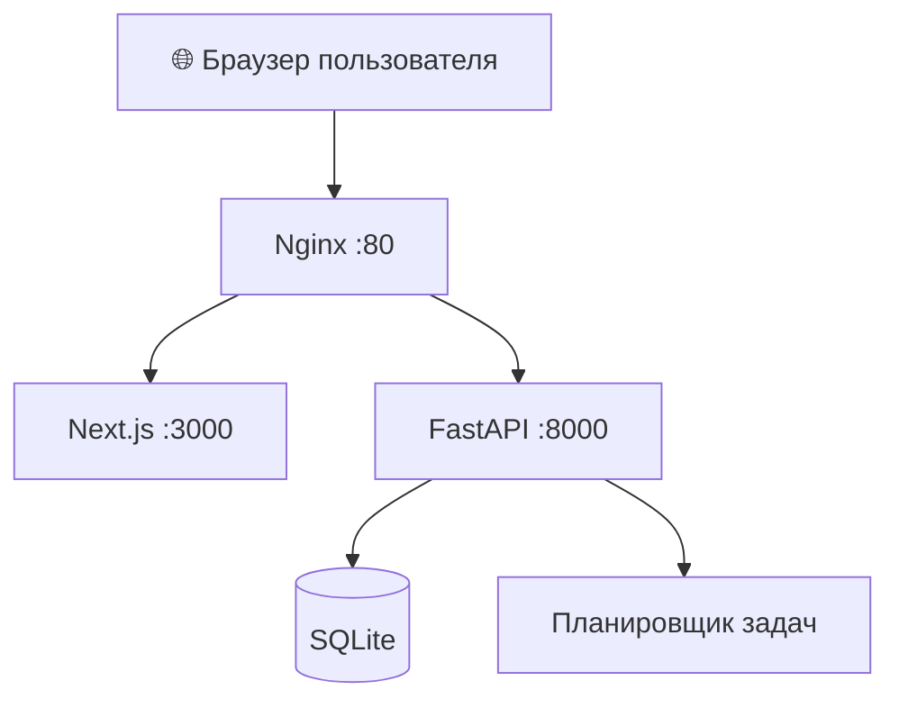

# ✨ Invoice Keeper

<p align="center">
  
</p>

<p align="center">
  <strong>Управляй регулярными платежами, организуй финансовые обязательства и держи всё под контролем.</strong>
</p>

<p align="center">
  <a href="http://217.144.184.236/">
    
  </a>
  <a href="http://217.144.184.236/api/v1/docs">
    
  </a>
</p>

<p align="center">
  
  
  
  
</p>

---

## 🌐 Попробовать онлайн

**[🚀 Открыть Invoice Keeper](http://217.144.184.236/)**

Документация API: [Swagger UI](http://217.144.184.236/api/v1/docs)

> ⚠️ Сейчас приложение доступно по HTTP. Не вводи реальные пароли и конфиденциальные финансовые данные, пока не настроен HTTPS.

## 📌 О проекте

**Invoice Keeper** — веб-приложение для удобного управления регулярными платежами и финансовыми обязательствами.

Проект объединяет современный интерфейс, API на Python и базу данных для хранения информации. Приложение развёрнуто на VPS и доступно через веб-браузер.

## ✨ Возможности

- 📅 **Регулярные платежи** — организация повторяющихся финансовых обязательств.
- 💰 **Управление данными** — работа с платежами в едином интерфейсе.
- 🔔 **Планировщик задач** — выполнение фоновых задач и напоминаний.
- 🔐 **Авторизация** — регистрация и вход пользователей через API.
- 🔌 **REST API** — взаимодействие с серверной частью через FastAPI.
- 🗄️ **Хранение данных** — база SQLite и ORM SQLAlchemy.
- 🚀 **Автозапуск** — службы приложения запускаются через systemd.
- 🌍 **Публикация в интернете** — Nginx принимает запросы и направляет их нужному компоненту.

*Доступные функции зависят от текущей реализации приложения.*

## 🛠️ Технологии

| Компонент | Технологии |
|---|---|
| Интерфейс | Next.js 15, React, TypeScript |
| Серверная часть | Python, FastAPI, Uvicorn |
| База данных | SQLite |
| Работа с данными | SQLAlchemy, Pydantic |
| Фоновые задачи | APScheduler |
| Веб-сервер | Nginx |
| Управление службами | systemd |
| Операционная система | Ubuntu |

## 🏗️ Архитектура проекта



Nginx принимает входящие запросы. Страницы приложения передаются в Next.js, а запросы к API — в FastAPI. Backend работает с базой данных SQLite и выполняет фоновые задачи.

## 📂 Структура проекта

```text
invoice-keeper/
├── backend/
│   ├── app/
│   │   ├── core/          # Конфигурация и базовые компоненты
│   │   └── ...            # API и бизнес-логика
│   ├── requirements.txt   # Зависимости Python
│   └── .env               # Переменные окружения
│
├── frontend/
│   ├── src/               # Исходный код интерфейса
│   ├── public/            # Статические файлы
│   ├── package.json       # Зависимости и команды npm
│   └── next.config.ts     # Конфигурация Next.js
│
└── README.md
```

## 🚀 Запуск локально

### Требования

- Node.js и npm
- Python 3.12 или совместимая версия
- SQLite

### 1. Клонирование репозитория

```bash
git clone https://github.com/ВАШ_ЛОГИН/ВАШ_РЕПОЗИТОРИЙ.git
cd ВАШ_РЕПОЗИТОРИЙ
```

Замени адрес на URL своего GitHub-репозитория.

### 2. Установка backend

```bash
cd backend

python3.12 -m venv .venv
source .venv/bin/activate

pip install -r requirements.txt
```

Создай файл `.env` и укажи необходимые настройки приложения: секретный ключ, пароль администратора и путь к базе данных.

Не используй секреты из чужих конфигураций и не публикуй свой `.env`.

### 3. Установка frontend

```bash
cd ../frontend

npm ci
npm run build
npm run start
```

Для разработки используй команду `npm run dev`, если она предусмотрена в `package.json`.

### 4. Развёртывание на сервере

Текущий экземпляр приложения работает со следующими компонентами:

- **Nginx** — внешний HTTP-сервер и прокси.
- **Next.js** — `127.0.0.1:3000`.
- **FastAPI** — `127.0.0.1:8000`.
- **systemd** — автоматический запуск и перезапуск служб.
- **SQLite** — постоянное хранение данных.

Для production-развёртывания настрой переменные окружения, доступ к базе данных, резервное копирование и HTTPS.

## 🔐 Безопасность

- Не добавляй `.env` и пароли в Git.
- Используй уникальный секретный ключ и сложный пароль администратора.
- Делай резервные копии базы перед обновлениями и изменениями схемы.
- Настрой HTTPS перед использованием реальных пользовательских данных.
- Оставляй внутренние порты приложения доступными только локально, если внешний доступ не требуется.
- Перед публикацией проверь, что база данных и резервные копии не попадут в открытый репозиторий.

## 🗺️ Планы развития

- [ ] Настроить HTTPS и подключить домен.
- [ ] Добавить скриншоты интерфейса.
- [ ] Расширить автоматические тесты.
- [ ] Документировать резервное копирование и восстановление.
- [ ] Настроить CI для автоматической проверки изменений.

## 🤝 Участие в проекте

Есть идея или нашёл ошибку? Буду рад предложениям и улучшениям.

1. Сделай Fork репозитория.
2. Создай отдельную ветку для изменений.
3. Внеси изменения и создай коммит.
4. Отправь Pull Request с описанием проделанной работы.

## 📄 Лицензия

Лицензия пока не указана. Если планируешь распространять проект как open source, добавь файл `LICENSE` с выбранной лицензией.

---

<p align="center">
  <strong>Invoice Keeper</strong><br/>
  <em>Меньше хаоса — больше контроля над финансами.</em>
</p>

<p align="center">
  <a href="http://217.144.184.236/">🚀 Открыть приложение</a>
  &nbsp;•&nbsp;
  <a href="http://217.144.184.236/api/v1/docs">📚 Документация API</a>
</p>
